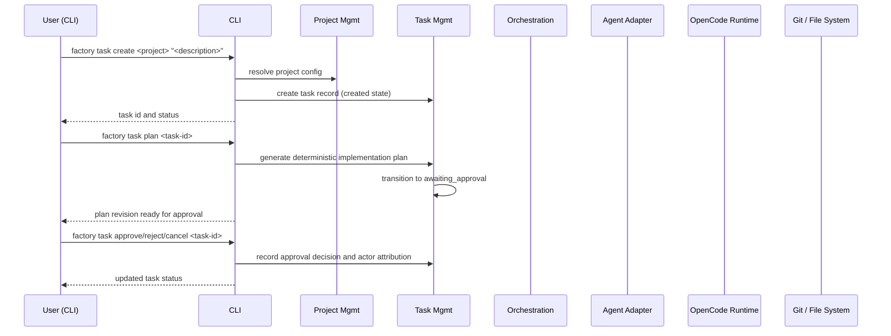

# ARCHITECTURE.md — Factory Lab Architectural Foundation

## Product Vision

Factory Lab is a general-purpose autonomous software development framework. It understands, plans, implements, tests, and delivers software changes across multiple projects and repositories.

- **Deployment:** Local-first, cloud-capable. Long-term: cloud execution with centralized management.
- **Interface:** CLI initially; web dashboard in the future.
- **Runtimes:** OpenCode initial coding runtime, via a replaceable adapter.
- **Models:** OpenRouter initial provider, via a provider abstraction.
- **Style:** Modular monolith with clearly defined component boundaries.

## System Boundaries

| In scope (Phase 1) | Out of scope (Phase 1) |
|---|---|
| Local project registration | Cloud worker infrastructure |
| Repository inspection and tech detection | Docker / container execution |
| Task intake and planning | Web dashboard / API layer |
| OpenCode execution initiation | Job queues / distributed execution |
| Execution status and result tracking | GitHub pull request creation |
| Approval gates for sensitive ops | Persistent application database |

## High-Level Architecture

```mermaid
graph TD
    CLI[CLI Application] --> Control[Control Plane]
    Control --> Project[Project Management]
    Control --> Task[Task Intake & Management]
    Control --> Orchestrate[Agent Orchestration]
    Control --> Model[Model Provider Adapters]
    Control --> Git[Git & Repo Integrations]

    Orchestrate --> Adapter[Coding Runtime Adapter]
    Adapter --> OpenCode[OpenCode Runtime]

    Execution[Execution Plane] --> Files[File Modifications]
    Execution --> Terminal[Terminal Commands]
    Execution --> Tests[Testing & Builds]
    Execution --> GitOps[Git Operations]

    Adapter --> Execution
    OpenCode --> Execution

    History[(Execution History & Logs)] <-- Control
    History <-- Execution
```

### Control Plane

Orchestration, task management, project management, agent coordination, model configuration, and execution tracking. Decides *what* to do and *when*.

### Execution Plane

Repository operations, file modifications, terminal commands, testing, builds, and Git operations. Performs *how* the change is applied.

The two planes communicate through well-defined interfaces; neither imports the other's internals directly.

## Component Responsibilities

| Component | Responsibility | Boundary |
|---|---|---|
| CLI application | Command parsing, user interaction, approval prompts | Entry point only |
| Project management | Project registration, config, tech detection, task history | Owns project state |
| Repository management | Repo discovery, workspace/gitworktree handling | Abstraction over Git CLI |
| Task intake & management | Task creation, status, lifecycle tracking, plan approval | Owns task state |
| Implementation planning | Deterministic implementation plan generation from project profile; tech overlays gated on inspection evidence | Control plane; no execution-plane imports |
| Agent orchestration | Agent delegation, state transitions | Stateful orchestration logic |
| Specialized agent roles | Architect, Developer, QA, Reviewer, EM | Logical roles, not separate model instances |
| Coding runtime adapters | OpenCode (initial), future runtimes | Translates plan → runtime execution |
| Model provider adapters | OpenRouter (initial), future providers | Abstraction over model API |
| Execution environments | Local workspace execution; future Docker/cloud | Abstracts where code runs |
| Git & repo integrations | Git CLI operations; GitHub API optional future | Repository-agnostic |
| Validation & QA | Lint, test execution, regression checks | Quality gates |
| Logging & observability | Execution logs, traces, status history | Observability surface |

Agent roles are logical responsibilities assigned to orchestration steps, not necessarily separate model instances or processes.

## Data Flow and Execution Lifecycle



1. **Register** — `factory project add <path>` stores project config and detects tech stack.
2. **Intake** — `factory task create <project> "<description>"` creates a task record in `created` state tied to a project.
3. **Plan** — `factory task plan <task-id>` generates a deterministic implementation plan via the control-plane planner; the plan enters `awaiting_approval`.
4. **Approve** — User reviews and approves/rejects/cancels the plan via `factory task approve` / `factory task reject` / `factory task cancel`; plan approval is part of Phase 1.
5. **Execute** — Deferred to M5: orchestration delegates to a coding runtime adapter (OpenCode).
6. **Track** — Status and history are recorded; user polls `factory task status` / `factory task show`.

## Local-to-Cloud Evolution

| Phase | Execution target | State store | Queue |
|---|---|---|---|
| Phase 1 (local) | Local workspace / process | In-memory + local files | None |
| Phase 2 | Local + Git worktrees | SQLite/PostgreSQL | None |
| Phase 3 | Docker containers local | PostgreSQL | Redis (optional) |
| Phase 4 | Cloud workers | PostgreSQL + centralized | Redis / cloud queue |

The execution environment interface is defined in Phase 1 so later containers/cloud workers slot in without changing orchestration.

## Integration and Adapter Strategy

- **Coding runtime:** OpenCode adapter implements `CodingRuntime` interface; other runtimes (e.g., Aider, custom) added later by implementing the same interface.
- **Model provider:** OpenRouter adapter implements `ModelProvider` interface; interchangeable without touching orchestration.
- **Repository:** Git CLI is the default; GitHub API integration is additive and never makes the framework GitHub-dependent.
- **Execution environment:** Local workspace first; Docker/cloud via environment abstraction later.

Adapters live behind interfaces in the control plane; the execution plane is invoked only through the runtime adapter.

## Security and Permissions Model

- Approval gates for: file writes outside project workspace, destructive Git operations, network-dependent commands, code delivery.
- All operations run under the invoking user's local permissions (no privilege escalation).
- Secrets (e.g., OpenRouter API keys) are read from environment; never logged or stored in plaintext.
- Project-scoped workspaces prevent cross-project file access.
- Audit log records every approved/rejected action with timestamp and actor.

---

## Confirmed decisions vs recommendations

Confirmed (from requirements): CLI-first, local-first/cloud-capable, OpenCode adapter, OpenRouter provider, modular monolith, control/execution plane separation, multi-project support, GitHub-first-but-not-dependent.

Recommendations requiring approval: PostgreSQL, Redis, LangGraph, OpenTelemetry, pgvector — all deferred past Phase 1 per Section 4 of the brief.
